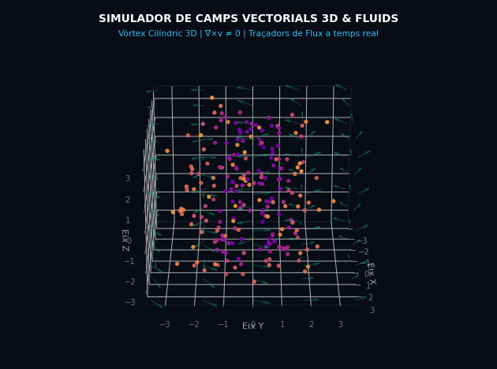

# Simulador de Camps Vectorials 3D & Mecànica de Fluids



> **Simulador interactiu en temps real per a l'exploració, anàlisi i visualització de camps vectorials 3D, fluxos laminars, funcions potencial ($\phi$) i funcions de corrent ($\psi$), desenvolupat com a eina d'aprenentatge i simulació per a les assignatures de **Mecànica de Fluids** i **Física de l'Estat Sòlid** (Grau en Física, Universitat Autònoma de Barcelona - UAB).**

---

### 🚧 Estat del projecte: En desenvolupament actiu (Work in Progress)
Aquest projecte és un prototip funcional en evolució constant. Actualment implementa visualització en volum 3D i pla 2D, traçadors de corrent a 60 fps i comprovador automàtic de constraints diferencials (Cauchy-Riemann, Laplace, divergència i vorticitat). Les properes versions incorporaran nous obstacles geomètrics i integració amb càlcul simbòlic.

---

## ⚡ Instruccions ràpides d'execució

No requereix cap procés de compilació ni configuració de servidors:

### Opció 1: Llançament ràpid amb Python
```bash
# Clona el repositori (si cal)
git clone https://github.com/el-teu-usuari/Vectors1.git
cd Vectors1

# Obre el simulador automàticament al teu navegador
python obrir_simulador.py
```

### Opció 2: Directament des del navegador
Obre el fitxer `visualitzador_camps.html` fent doble clic o arrossegant-lo a qualsevol navegador modern (Chrome, Edge, Firefox, Safari). Les llibreries 3D (`Three.js` i `OrbitControls`) es carreguen automàticament via CDN.

---

## 🚀 Característiques principals

- **Motor Tridimensional a 60 fps (Three.js & WebGL)**:
  - Exploració interactiva amb ratolí: rotació orbital 3D, zoom suau i desplaçament (*pan*).
  - Caixa cúbica delimitadora $[-5, 5]^3$ amb eixos de coordenades espacials $X, Y, Z$.
- **Traçadors de corrent en temps real (*Stream Tracers*)**:
  - 1.500 partícules que integren numèricament l'equació de moviment $\frac{d\vec{r}}{dt} = \vec{v}(\vec{r}, t)$ pas a pas, revelant visualment el transport real del fluid, fonts, embornals i vòrtexs.
- **Graella vectorial 3D adaptativa**:
  - Orientació exacta mitjançant quaternions i codificació cromàtica (*Turbo/Viridis*) segons la magnitud local de la velocitat $|\vec{v}|$.
- **Suport dual 3D Volumètric & 2D Pla**:
  - Commutador per treballar amb camps purament tridimensionals o restringir l'espai al pla $Z = z_{\text{tall}}$ per analitzar fluxos 2D sense saturació visual.

---

## 📐 Formulació matemàtica i Constraints físiques

El simulador admet 4 modes d'entrada a la columna de controls:

1. **Components directes $(u, v, w)$**:
   - Permet introduir qualsevol camp vectorial $\vec{v}(x, y, z, t)$ amb expressions algebraiques o trigonomètriques.
2. **Funció Potencial $\phi(x, y, t)$**:
   - Calcula les velocitats derivant el gradient: $u = \frac{\partial\phi}{\partial x}$, $v = \frac{\partial\phi}{\partial y}$.
   - **Constraint**: Avalua el Laplacià $\nabla^2\phi$. Si $\nabla^2\phi = 0$ (Laplace), verifica que el flux és **incompressible** i **irrotacional**.
3. **Funció de Corrent $\psi(x, y, t)$**:
   - Determina el flux incompressible per construcció: $u = \frac{\partial\psi}{\partial y}$, $v = -\frac{\partial\psi}{\partial x}$.
   - **Constraint**: Avalua la vorticitat $\omega_z = -\nabla^2\psi$. Si $\omega_z = 0$, el flux és irrotacional; si $\omega_z \neq 0$, alerta de presència de rotacional (sense potencial).
4. **Conjunt conjugat ($\phi$ i $\psi$)**:
   - Comprova numèricament les **condicions de Cauchy-Riemann**:
     $$\frac{\partial\phi}{\partial x} = \frac{\partial\psi}{\partial y}, \qquad \frac{\partial\phi}{\partial y} = -\frac{\partial\psi}{\partial x}$$
   - Mostra que les línies de corrent ($\psi = \text{ct}$) i les línies equipotencials ($\phi = \text{ct}$) són ortogonals arreu.

---

## 📚 Presets dels Problemes de Fluids

S'han integrat presets directes per als exercicis del full acadèmic (disponibles a la carpeta `Fluids/`):

- **Exercici 12 (Cinemàtica - Flux hiperbòlic)**:
  - $\vec{u} = (ax, -ay, 0) \implies \phi = \frac{a}{2}(x^2 - y^2), \quad \psi = axy$.
  - Línies de corrent hiperbòliques $xy = C$.
- **Exercici 13 (Vòrtex rígid)**:
  - $\vec{u} = -3y\vec{\imath} + 3x\vec{\jmath} \implies \psi = \frac{3}{2}(x^2 + y^2)$.
  - Camp incompressible amb vorticitat constant $\omega_z = 6$ (sense funció potencial).
- **Exercici 16 (Flux lineal general)**:
  - **Cas potencial & corrent ($\alpha=3, \beta=2$)**:
    $$\phi(x,y) = \frac{3}{2}x^2 + 2xy - \frac{3}{2}y^2, \qquad \psi(x,y) = y^2 + 3xy - x^2$$
    Compleix Cauchy-Riemann i té tant potencial com funció de corrent.
  - **Cas amb vorticitat ($\alpha=3, \beta \neq 2$)**:
    Conserva la funció de corrent $\psi$ (per incompressibilitat), però la vorticitat $\omega_z = \beta - 2 \neq 0$ trenca l'existència del potencial $\phi$.
- **Exercici 4 (Cilindre / Protuberància semicircular)**:
  - Suport natiu de coordenades polars planes ($r = \sqrt{x^2+y^2}$, $\theta = \text{atan2}(y,x)$):
    $$\phi(r,\theta) = \left(r^2 + \frac{a^4}{r^2}\right)\cos(2\theta), \qquad \psi(r,\theta) = \left(r^2 - \frac{a^4}{r^2}\right)\sin(2\theta)$$
- **Exercici 15 (Flux no estacionari amb temps $t$)**:
  - $u = x(1 + 2t), \; v = y$. Demostra la diferència entre línies de corrent instantànies i trajectòries temporals.

---

## 🛠️ Tecnologies emprades

- **Frontend / Visualització**: HTML5, CSS3 Modern, Vanilla JavaScript (ES6+).
- **Gràfics 3D**: [Three.js](https://threejs.org/) (WebGL), `OrbitControls`.
- **Eines científiques auxiliars**: Python 3, NumPy, Matplotlib, Pillow (generació de previews i llançador multiplataforma).
- **Inspiració de disseny**: Simuladors d'Estat Sòlid de la Universitat Autònoma de Barcelona (UAB).

---

## 👤 Autor
Desenvolupat com a projecte interactiu de simulació física per al Grau en Física.
